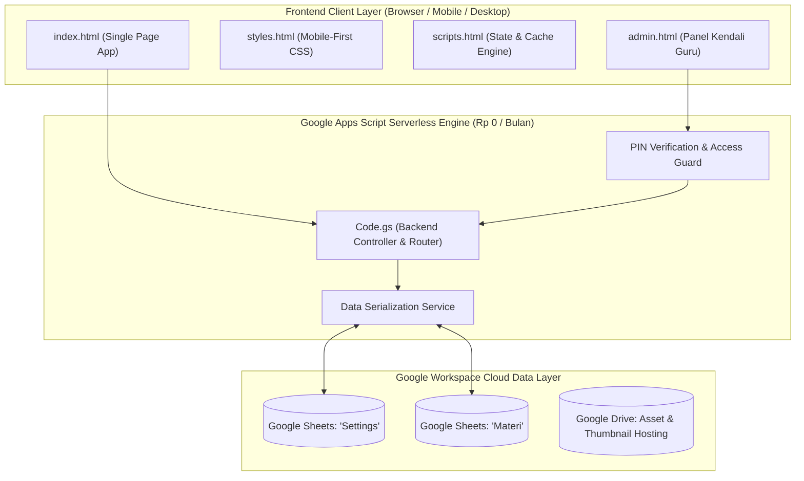
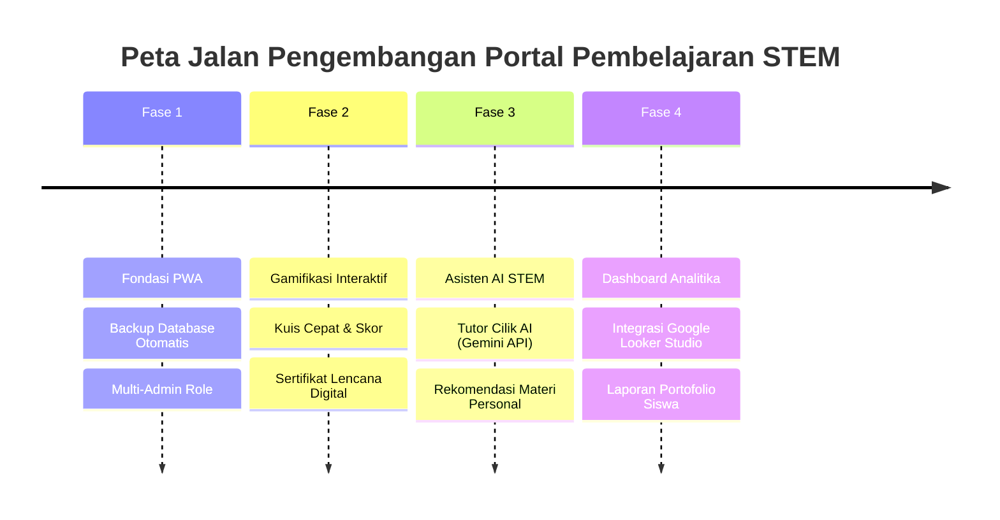
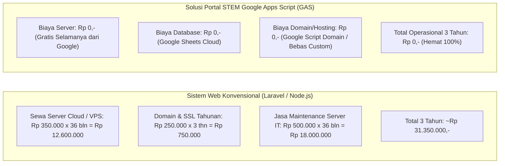

# 📑 DOKUMEN TEKNIS RENCANA PENGEMBANGAN & PROPOSAL PENAWARAN HARGA
## SISTEM PORTAL PEMBELAJARAN STEM SEKOLAH BERBASIS GOOGLE APPS SCRIPT (GAS)

---

**Nomor Dokumen**: `PROP-STEM/2026/X/001`  
**Tanggal**: 26 Oktober 2026  
**Status**: Proposal Resmi & Dokumen Spesifikasi Teknis  
**Disusun Oleh**: Tim Rekayasa Perangkat Lunak & Konsultan EdTech (Virtual Engineering Team)  
**Ditujukan Kepada**: Pimpinan / Kepala Sekolah & Tim Pengembang Kurikulum STEM  

---

## Executive Summary

Perkembangan kurikulum pendidikan modern menuntut integrasi pendekatan **STEM (*Science, Technology, Engineering, Mathematics*)** yang interaktif, menyenangkan, dan mudah diakses oleh seluruh siswa sekolah dasar (SD). Kendala umum yang sering dihadapi institusi pendidikan dalam mengadopsi platform digital adalah **tingginya biaya sewa server bulanan (VPS/Cloud)**, kerumitan instalasi, serta kebutuhan tim IT khusus untuk pemeliharaan sistem.

**Portal Pembelajaran STEM Sekolah Berbasis Google Apps Script (GAS)** hadir sebagai solusi *game-changer*:
1. **Biaya Infrastruktur Rp 0,- (Zero Server Cost)**: Memanfaatkan ekosistem komputasi awan Google Cloud Platform & Google Drive / Google Sheets institusi secara penuh tanpa tagihan berlangganan server bulanan.
2. **Kesiapan Pakai & Ringan (*Lightweight & Ultra-Fast*)**: Berjalan langsung di peramban web (*browser-based*) smartphone, tablet, maupun komputer kelas tanpa perlu unduh aplikasi dari Play Store / App Store.
3. **Mudah Dikelola Guru**: Seluruh pangkalan data materi, identitas sekolah, tautan video, simulasi PhET, dan kontak bantuan dikelola melalui antarmuka visual Dashboard Admin atau langsung via *spreadsheet* Google Sheets yang akrab bagi para pendidik.

Dokumen ini merinci **Arsitektur Teknis Sistem**, **Peta Jalan Pengembangan Fitur Lanjutan (*Development Roadmap*)**, **Jadwal Pelaksanaan Proyek (*WBS*)**, serta **Rincian Struktur Penawaran Biaya (*Commercial Quotation*)** secara transparan dan terukur.

---

## 1. Analisis Sistem & Arsitektur Solusi

### 1.1 Kondisi Sistem Saat Ini (*As-Is State* - Rilis v1.3.x)
Platform telah berhasil dibangun dan diuji dengan kapabilitas:
- **Arsitektur Modular Murni GAS**: Berkas program terisolasi rapi menjadi `index.html` (shell publik), `styles.html` (desain visual modern), `scripts.html` (logika interaktif & state management), `admin.html` (portal manajemen guru), dan `Code.gs` (backend micro-service). Bebas dari dependensi berkas `.css` dan `.js` eksternal.
- **Tampilan Beranda Bersih & Ramah Anak**: Menampilkan identitas sekolah, hero banner ringkas, dan 4 Card Utama Kategori STEM dalam formasi 2 kolom mobile yang proporsional.
- **Sistem Penguncian Jenjang Kelas (*Grade-Locking Mechanism*)**: Pemilihan jenjang kelas (Kelas 1–6 SD) memfilter materi secara presisi dan menyembunyikan elemen distraksi.
- **Modal Misi Eksplorasi Interaktif**: Menyajikan panduan belajar terstruktur (Tujuan Belajar, Langkah Praktikum, Tombol Simulasi Eksternal/PhET/Blockly/Video, dan Pertanyaan Refleksi).
- **Dashboard Admin Terpadu**: Dilindungi enkripsi PIN keamanan, mendukung kustomisasi logo 4 pilar STEM, data kontak sekolah, dan manajemen kartu materi (CRUD).
- **Desain Universal Responsif**: Dioptimalkan penuh untuk resolusi layar smartphone (360px–480px), tablet (768px), hingga monitor komputer (1024px+).



---

## 2. Rencana Pengembangan Lanjutan (*To-Be Roadmap*)

Untuk meningkatkan keterlibatan siswa dan memperkuat efektivitas pembelajaran di kelas, pengembangan platform dirancang dalam 4 fase modular:



### 🚀 Fase 1: Pemantapan Fondasi & PWA (Progressive Web Application)
- **Instalasi PWA 1-Klik**: Aplikasi dapat di-*install* langsung ke layar utama smartphone Android & iOS seperti aplikasi native tanpa melalui toko aplikasi.
- **Mode Offline Cerdas (*Service Worker Cache*)**: Materi teks panduan praktikum dan ringkasan konsep tetap dapat diakses meski siswa kehabisan kuota atau sinyal tidak stabil.
- **Sistem Cadangan (*Automated Daily Backup*)**: Pembuatan salinan data Google Sheets harian otomatis ke folder khusus di Google Drive administrator.
- **Multi-Level PIN Admin**: Pemisahan hak akses antara Super Admin (Kepala Sekolah/Koordinator IT) dan Guru Mata Pelajaran.

### 🎮 Fase 2: Gamifikasi & Asesmen Formatif Mandiri
- **Modul Kuis Interaktif Ramah Anak**: Mini kuis pilihan ganda 3–5 soal setelah siswa menyelesaikan simulasi materi, dilengkapi efek suara (*sound effect*) dan animasi apresiasi.
- **Lencana Digital Prestasi (*Digital STEM Badges*)**: Siswa mengumpulkan lencana virtual (misal: *"Penjelajah Galaksi Cilik"*, *"Ahli Mekanika Kertas"*, *"Penyelidik Sudut"*).
- **Cetak Sertifikat Mandiri**: Fitur unduh dan cetak sertifikat penghargaan digital dalam format PDF berlogo resmi sekolah secara otomatis.

### 🤖 Fase 3: Integrasi Asisten Pintar AI (Google Gemini API)
- **Tutor Virtual STEM AI ("Kakak Robot STEM")**: Siswa dapat mengajukan pertanyaan sains/matematika dengan gaya bahasa ramah anak SD.
- **Safety Guardrail & Safe Search**: Algoritma pelindung yang memastikan jawaban AI 100% aman, edukatif, dan sesuai dengan tahapan usia anak SD (bebas dari konten dewasa atau bahasa rumit).
- **Generator Soal Praktikum untuk Guru**: Fitur di dashboard admin untuk membantu guru merancang skenario praktikum baru secara instan berbasis AI.

### 📊 Fase 4: Analitika Pembelajaran & Dashboard Pimpinan
- **Dashboard Analitika Google Looker Studio**: Visualisasi real-time materi yang paling diminati siswa, jumlah eksplorasi per jenjang kelas, dan tingkat penyelesaian kuis.
- **Laporan Kinerja Kurikulum STEM**: Rekap data berkala dalam format PDF/Excel siap pakai untuk evaluasi kepala sekolah, dinas pendidikan, atau akreditasi sekolah.

---

## 3. Metodologi Pengerjaan & Tim Pelaksana

Proyek dikerjakan menggunakan kerangka kerja **Agile / Scrum Adaptif** dengan sprint terukur per 2 minggu:

| Peran Tim Spesialis | Tanggung Jawab Utama |
|---|---|
| **Solution Architect & Project Lead** | Perancangan arsitektur Google Apps Script, integrasi Google Workspace, jaminan keamanan data dan tata kelola sistem. |
| **Senior Frontend Engineer** | Penyusunan CSS murni responsif, fluid typography, interaksi touch-friendly mobile, serta performa rendering cepat. |
| **Backend & GAS Specialist** | Optimasi script Google Apps Script (V8 runtime), caching Sheets API, dan manajemen kuota eksekusi Google. |
| **EdTech & Curriculum Consultant** | Kurasi konten praktikum STEM SD, sinkronisasi tautan simulasi resmi (PhET, Blockly, dll.), dan penyusunan instrumen refleksi siswa. |
| **QA & Software Tester** | Pengujian lintas perangkat (Android, iPhone, iPad, Chromebook, Laptop), audit keamanan web, dan verifikasi zero-bug. |

---

## 4. Penawaran Harga & Paket Pengembangan

Kami menyediakan 3 opsi paket pengembangan yang dapat disesuaikan dengan skala kebutuhan, target capaian, dan anggaran institusi:

### 4.1 Rincian Matriks Paket Solusi

| Komponen Fitur & Layanan | Paket A: Standar (Basic Portal) | Paket B: Profesional (Gamifikasi & PWA) | Paket C: Enterprise (AI & Analitika Terpadu) |
|---|:---:|:---:|:---:|
| **Portal Web STEM Modular GAS** (v1.3.x Siap Pakai) | ✅ Termasuk | ✅ Termasuk | ✅ Termasuk |
| **Kategori STEM 4 Pilar** (Sains, Teknologi, Rekayasa, Matematika) | ✅ Termasuk | ✅ Termasuk | ✅ Termasuk |
| **Penguncian Jenjang Kelas (Kelas 1–6 SD)** | ✅ Termasuk | ✅ Termasuk | ✅ Termasuk |
| **Modal Misi Eksplorasi & Simulasi Terintegrasi** | ✅ Termasuk | ✅ Termasuk | ✅ Termasuk |
| **Dashboard Admin PIN & Kustomisasi Logo Sekolah** | ✅ Termasuk | ✅ Termasuk | ✅ Termasuk |
| **Panduan Deploy & Dokumentasi Teknis Lengkap** | ✅ Termasuk | ✅ Termasuk | ✅ Termasuk |
| **Pemasangan (*Setup*) Langsung di Akun Google Sekolah** | ✅ Termasuk | ✅ Termasuk | ✅ Termasuk |
| **Progressive Web App (PWA) Mobile Installable** | ❌ Belum | ✅ Termasuk | ✅ Termasuk |
| **Modul Kuis Interaktif & Lencana Prestasi Digital** | ❌ Belum | ✅ Termasuk | ✅ Termasuk |
| **Sistem Cetak Sertifikat Digital PDF Otomatis** | ❌ Belum | ✅ Termasuk | ✅ Termasuk |
| **Asisten Belajar Cilik Google Gemini AI (Safe Guard)** | ❌ Belum | ❌ Belum | ✅ Termasuk |
| **Dashboard Statistik Google Looker Studio Pimpinan** | ❌ Belum | ❌ Belum | ✅ Termasuk |
| **Pelatihan Daring Guru & Administrator** | 1 Sesi (2 Jam) | 2 Sesi (4 Jam) | 3 Sesi (Pendampingan Intensif) |
| **Masa Garansi & Pemeliharaan Bebas Bug** | 1 Bulan | 3 Bulan | 6 Bulan |
| **Estimasi Waktu Pengerjaan / Integrasi** | **3–5 Hari Kerja** | **2–3 Minggu** | **4–6 Minggu** |
| **Total Investasi (IDR)** | **Rp 4.500.000,-** | **Rp 8.750.000,-** | **Rp 15.500.000,-** |

*(Catatan: Harga di atas adalah tarif bersih / all-in jasa rekayasa perangkat lunak, konfigurasi, dan pendampingan, tanpa biaya bulanan apa pun ke depannya).*

---

### 4.2 Analisis Efisiensi Biaya (TCO - Total Cost of Ownership)

Bandingkan pengeluaran sistem berbasis Google Apps Script dengan aplikasi web konvensional selama 3 tahun operasional:



> **Kesimpulan Finansial**: Memilih arsitektur Google Apps Script menghemat biaya operasional institusi pendidikan hingga **Rp 30.000.000+** dalam 3 tahun pertama, menjadikannya investasi teknologi yang paling efisien dan tepat guna bagi sekolah.

---

## 5. Rencana Jadwal Pelaksanaan (*WBS & Timeline*)

Berikut adalah linimasa kerja standar untuk paket implementasi:

```
Minggu 1: Persiapan & Penyelarasan
├── Kick-off meeting & finalisasi data awal kurikulum STEM sekolah
├── Pengaturan izin akses Google Workspace / Google Drive sekolah
└── Setup repositori, sheet template, dan staging environment

Minggu 2: Implementasi Inti & Desain Antarmuka
├── Deployment modul backend Code.gs & konfigurasi Google Sheets
├── Pemasangan tema identitas sekolah (Logo, Warna, Kontak WhatsApp)
└── Pemasangan materi awal sesuai kebutuhan jenjang sekolah

Minggu 3: Pengujian Menyeluruh & UAT (User Acceptance Testing)
├── Pengujian responsivitas mobile di peramban siswa
├── Pengujian input data admin dan kustomisasi materi oleh perwakilan guru
└── Audit fungsional, performa kecepatan muat, dan perbaikan minor

Minggu 4: Serah Terima, Pelatihan, & Go-Live
├── Sesi pelatihan resmi guru kelas dan staf IT sekolah
├── Penyerahan dokumen operasional dan kode sumber lengkap
└── Peluncuran resmi portal kepada siswa dan orang tua
```

---

## 6. Syarat & Ketentuan Pembayaran (*Commercial Terms*)

1. **Jadwal Termin Pembayaran**:
   - **Termin I (Uang Muka / Down Payment)**: 30% dibayarkan saat penandatanganan surat perintah kerja / persetujuan proposal.
   - **Termin II (Pengujian / UAT Selesai)**: 40% dibayarkan setelah seluruh modul berfungsi dan disetujui pada sesi demonstrasi sistem.
   - **Termin III (Serah Terima Akhir & Pelatihan)**: 30% pelunasan setelah serah terima berkas, hak akses penuh, dan sesi pelatihan guru selesai dilaksanakan.
2. **Kebutuhan Sistem Pihak Sekolah**:
   - Akun Google / Google Workspace for Education yang aktif (gratis dari Kemendikbudristek / Google).
   - Daftar kontak resmi sekolah (Nomor WhatsApp Pengelola & Nama Sekolah).
3. **Layanan Purnajual & Garansi**:
   - Jaminan perbaikan bebas biaya (*free bug-fixing*) sesuai periode garansi paket.
   - Dukungan konsultasi teknis melalui grup komunikasi WhatsApp khusus.

---

## 7. Lembar Konfirmasi & Persetujuan

Untuk menyetujui proposal teknis dan penawaran harga ini, silakan menandatangani lembar persetujuan di bawah ini atau memberikan konfirmasi balasan resmi:

| Disetujui Oleh (Pihak Sekolah) | Diajukan Oleh (Tim Pengembang) |
|---|---|
| <br><br><br>____________________________________<br>Nama: <br>Jabatan: <br>Tanggal: | <br><br><br>____________________________________<br>Nama: **Lead Solution Architect**<br>Jabatan: **Lead EdTech Consultant**<br>Tanggal: 26 Oktober 2026 |

---
*Dokumen ini disusun dengan mengedepankan efisiensi anggaran, keandalan arsitektur modern Google Workspace, dan kemudahan penggunaan bagi ekosistem pendidikan sekolah.*
