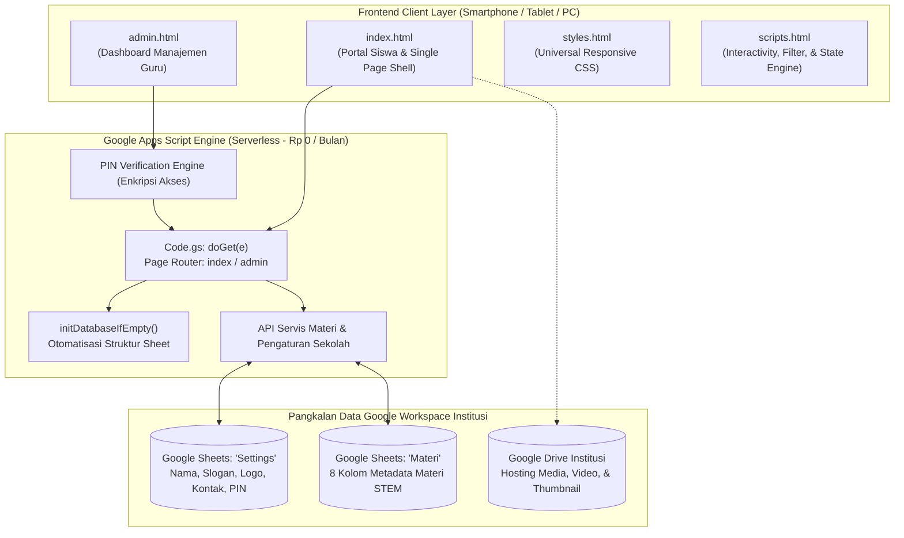
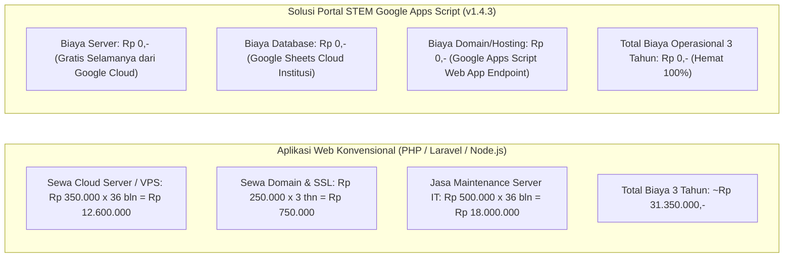

# 📑 DOKUMEN SPESIFIKASI TEKNIS & PROPOSAL PENAWARAN SISTEM
## SISTEM PORTAL PEMBELAJARAN STEM SEKOLAH BERBASIS GOOGLE APPS SCRIPT (GAS)
### Versi Rilis: v1.4.3 (Ready-to-Use Production System)

---

**Nomor Dokumen**: `PROP-STEM/2026/X/002`  
**Tanggal**: 26 Oktober 2026  
**Status**: Proposal Resmi & Dokumen Spesifikasi Sistem Siap Pakai  
**Disusun Oleh**: Tim Rekayasa Perangkat Lunak & Konsultan EdTech (Virtual Engineering Team)  
**Ditujukan Kepada**: Pimpinan / Kepala Sekolah & Tim Pengembang Kurikulum STEM  

---

## Executive Summary

Penerapan pendekatan **STEM (*Science, Technology, Engineering, Mathematics*)** di jenjang pendidikan dasar menjadi kunci dalam membangun nalar kritis, kreativitas, dan literasi digital peserta didik sejak dini. Namun, kendala utama yang kerap dihadapi sekolah adalah **tingginya biaya sewa server bulanan (*VPS / Cloud Hosting*)**, kerumitan instalasi aplikasi, serta kebutuhan tim teknis khusus untuk pemeliharaan rutin.

**Portal Pembelajaran STEM Sekolah Berbasis Google Apps Script (GAS)** hadir sebagai solusi komprehensif yang telah selesai dikembangkan dan siap pakai (*production-ready*):

1. **Biaya Infrastruktur Rp 0,- (Zero Server Cost Selamanya)**:  
   Berjalan 100% di atas komputasi awan Google Cloud Platform menggunakan akun Google Workspace institusi sekolah, dengan Google Sheets sebagai pangkalan data awan. Bebas biaya sewa server, domain, maupun database bulanan.
2. **Akses Instan Tanpa Instalasi (*Ultra-Fast Web App*)**:  
   Dapat diakses langsung melalui peramban web (*browser*) di smartphone, tablet, laptop, maupun Chromebook tanpa perlu mengunduh aplikasi dari Google Play Store atau Apple App Store.
3. **Pengelolaan Mandiri & Ramah Guru**:  
   Seluruh konten materi praktikum, identitas sekolah, logo instansi, serta tautan video dan simulasi dikelola dengan sangat mudah melalui Dashboard Admin visual atau langsung via *spreadsheet* Google Sheets yang sudah akrab bagi para pendidik.
4. **Desain Mobile-First & Ergonomis**:  
   Antarmuka beranda mengadopsi formasi 2 kolom kartu STEM yang seimbang di ponsel, filter 1 baris kompak, serta penempatan tombol aksi di bawah formulir demi kemudahan jangkauan jempol pengguna di perangkat bergerak.

Dokumen ini memaparkan **Spesifikasi Teknis Sistem Saat Ini (v1.4.3)**, **Struktur Arsitektur**, **Alur Pemasangan (*Deployment*)**, serta **Rincian Paket Penawaran Serah Terima & Implementasi Sistem** secara transparan.

---

## 1. Arsitektur Sistem & Spesifikasi Komponen

### 1.1 Struktur Arsitektur Google Apps Script (GAS)
Aplikasi dibangun menggunakan arsitektur modular murni Google Apps Script tanpa dependensi berkas `.css` atau `.js` eksternal terpisah (memenuhi regulasi resmi lingkungan Google Apps Script):



### 1.2 Struktur Berkas Proyek (*Deliverable Files*)

Platform terdiri atas 5 berkas inti yang terstruktur secara bersih:

| No | Nama Berkas | Peran & Fungsi Utama |
|:---:|---|---|
| 1 | **`Code.gs`** | Backend Google Apps Script: menangani routing web app (`doGet`), inisialisasi pangkalan data Google Sheets otomatis, CRUD materi, verifikasi keamanan PIN Admin, dan sinkronisasi data pengaturan. |
| 2 | **`index.html`** | Halaman muka portal siswa: menampilkan identitas sekolah, formasi 2 kolom kartu STEM, selektor jenjang kelas, dan modal misi eksplorasi praktikum interaktif. |
| 3 | **`styles.html`** | Sistem desain visual terpadu: palet warna HSL modern, formasi 2 kolom mobile, filter 1 baris kompak, topbar admin 1 baris, dan isolasi responsif bebas horizontal overflow. |
| 4 | **`admin.html`** | Dashboard admin guru mandiri (*standalone-ready*): autentikasi PIN, manajemen materi STEM, kustomisasi logo & profil sekolah, panduan deploy, dan penampil kode sumber. |
| 5 | **`scripts.html`** | Mesin interaktivitas klien: penanganan filter kelas, pencarian real-time, validasi formulir, integrasi Google Script Run API, dan fallback penyimpanan lokal (*cache*). |

---

## 2. Fitur & Kapabilitas Sistem Saat Ini (Rilis v1.4.3)

Sistem telah rampung dikembangkan, diuji, dan diverifikasi dengan fitur-fitur operasional berikut:

### 2.1 Modul Portal Pembelajaran Siswa
- **Formasi 2 Kolom Kartu STEM Ramah Ponsel**: 4 Pilar Utama STEM (*Science, Technology, Engineering, Mathematics*) disajikan dalam formasi kartu 2 kolom yang padat dan menarik di smartphone, meminimalkan kebutuhan menggulir (*scrolling*).
- **Penguncian Jenjang Kelas (*Grade-Locking Selector*)**: Siswa dapat memilih jenjang kelas (Kelas 1 hingga Kelas 6 SD) untuk secara instan memfilter materi yang relevan dengan kurikulum tingkatannya.
- **Modal Misi Eksplorasi Interaktif**: Setiap sub-card materi dilengkapi jendela misi belajar terstruktur:
  - *Tujuan Pembelajaran*: Poin capaian kompetensi dasar yang ringkas.
  - *Langkah Praktikum*: Panduan aktivitas mandiri langkah-demi-langkah.
  - *Media Interaktif*: Tautan video pembelajaran dan tombol simulasi langsung (mendukung PhET Interactive Simulations, Blockly Games, Google Earth, YouTube Kids, dll.).
  - *Pertanyaan Refleksi*: Kolom evaluasi mandiri untuk memicu nalar kritis siswa.
- **Desain Universal Bebas Distraksi**: Tipografi ramah anak, tombol sentuh berukuran proporsional (*minimum 44x44px*), dan performa *rendering* instan tanpa *loading* berat.

### 2.2 Modul Dashboard Manajemen Guru & Administrator
- **Autentikasi PIN Keamanan Terpadu**: Dilindungi PIN admin (PIN Demo `123456` bawaan yang dapat diganti sewaktu-waktu oleh sekolah melalui formulir pengaturan).
- **Topbar Admin 1 Baris Penuh (*No-Wrap Topbar*)**: Seluruh elemen navigasi atas (toggle sidemenu, judul panel, dan tombol kembali ke portal siswa) terkunci rapi dalam 1 baris horizontal di seluruh resolusi layar ponsel (360px–480px).
- **Manajemen Materi Praktikum STEM (CRUD Lengkap)**:
  - Guru dapat **Menambah**, **Mengedit**, dan **Menghapus** konten kartu materi STEM secara visual.
  - Metadata lengkap: Kategori STEM, Judul, Jenjang Kelas (1–6 / Semua Kelas), URL Thumbnail, Panduan Langkah, Tautan Video, Tautan Simulasi, dan Refleksi.
- **Filter Tabel 1 Baris Kompak**:
  - Kolom pencarian kata kunci, dropdown Kategori STEM, dan dropdown Jenjang Kelas tersusun sejajar dalam 1 baris horizontal responsif, menghemat ruang layar vertikal hingga 65%.
- **Ergonomi Akses Ponsel (*Thumb-Zone Friendly*)**:
  - Tombol aksi utama (`+ Tambah Sub-Card Baru`) diletakkan di bawah baris filter.
  - Tombol aksi `Simpan Pengaturan` diletakkan di bawah formulir pengaturan, memudahkan guru menyelesaikan pengisian data menggunakan jempol di ponsel tanpa perlu menggulir kembali ke atas.
- **Kustomisasi Identitas & Logo Sekolah Terpadu**:
  - Nama Sekolah, Tahun Ajaran Aktif, Slogan Sekolah, dan Nomor WhatsApp Bantuan.
  - Kustomisasi tautan Logo Utama Sekolah dan logo khusus untuk masing-masing dari 4 kategori STEM.
  - *Live Preview Panel*: Pratinjau visual perubahan logo dan identitas secara waktu-nyata (*real-time*) sebelum disimpan.

### 2.3 Modul Panduan Deploy Mandiri & Interactive Code Viewer
- **Panduan Penerapan 7 Langkah (*Self-Deployment Hub*)**: Panduan bergambar terstruktur langsung di dalam panel admin yang memandu guru menghubungkan spreadsheet dan mempublikasikan web app ke Google Apps Script.
- **Penampil Kode Sumber 5 Berkas Interaktif**: Menyajikan kode sumber lengkap dari 5 berkas sistem (`Code.gs`, `index.html`, `styles.html`, `admin.html`, `scripts.html`) lengkap dengan tombol **"Salin Kode"** 1-klik (*copy to clipboard*).

### 2.4 Dukungan Dual-Mode (Online GAS & Offline Standalone)
- **Mode Cloud GAS**: Berjalan terintegrasi dengan Google Sheets sebagai basis data awan.
- **Mode Offline Standalone**: Berkas `admin.html` dan `index.html` dapat dibuka langsung di peramban secara lokal tanpa kendala blokir CORS (*Cross-Origin Resource Sharing*), didukung skrip web server lokal ringan (`server.js`).

---

## 3. Analisis Efisiensi Biaya (TCO - Total Cost of Ownership)

Perbandingan pengeluaran operasional infrastruktur sistem Portal STEM berbasis Google Apps Script dibandingkan sistem web konvensional selama 3 tahun operasional:



> **Keuntungan Finansial Institusi**: Memilih arsitektur Google Apps Script mengeliminasi 100% beban biaya operasional server, menghemat kas sekolah **lebih dari Rp 30.000.000,-** selama 3 tahun masa pakai.

---

## 4. Paket Penawaran Biaya Implementasi & Serah Terima Sistem

Karena seluruh platform perangkat lunak **telah selesai dibangun dan berstatus siap pakai (v1.4.3)**, struktur penawaran difokuskan pada lisensi kode sumber, jasa penyiapan (*setup/deployment*) di akun Google sekolah, kustomisasi identitas, serta pelatihan guru:

### 4.1 Matriks Paket Penawaran

| Komponen Layanan & Serah Terima | Paket A: Mandiri (Source Code & Guide) | Paket B: Profesional (Setup Penuh & Kustomisasi) | Paket C: Enterprise (Pendampingan & Optimasi Penuh) |
|---|:---:|:---:|:---:|
| **Paket Kode Sumber Lengkap v1.4.3** (`Code.gs`, `index.html`, `styles.html`, `admin.html`, `scripts.html`) | ✅ Termasuk | ✅ Termasuk | ✅ Termasuk |
| **Dokumen Panduan Deploy & Operasional Guru** | ✅ Termasuk | ✅ Termasuk | ✅ Termasuk |
| **Pemasangan (*Setup*) Langsung di Akun Google Sekolah** | ❌ Mandiri | ✅ Ditangani Tim | ✅ Ditangani Tim |
| **Konfigurasi Database Google Sheets Sekolah** | ❌ Mandiri | ✅ Ditangani Tim | ✅ Ditangani Tim |
| **Kustomisasi Profil Sekolah, Logo & Nomor Bantuan** | ❌ Mandiri | ✅ Dikonfigurasi | ✅ Dikonfigurasi |
| **Input Data Awal Materi STEM Kurikulum Sekolah** | ❌ Mandiri | ✅ 12 Materi Awal | ✅ 24 Materi Lengkap |
| **Sesi Pelatihan Daring untuk Guru & Tim IT** | ❌ Tidak Ada | 1 Sesi (2 Jam) | 2 Sesi (Pendampingan Praktik) |
| **Optimasi Tautan Media Google Drive Sekolah** | ❌ Tidak Ada | ✅ Termasuk | ✅ Termasuk |
| **Masa Garansi & Pemeliharaan Bebas Bug** | 1 Bulan | 3 Bulan | 6 Bulan |
| **Dukungan Konsultasi Teknis WhatsApp Group** | 1 Bulan | 3 Bulan | 6 Bulan |
| **Estimasi Waktu Pemasangan & Go-Live** | **Instan (1 Hari)** | **2–3 Hari Kerja** | **3–5 Hari Kerja** |
| **Total Investasi (IDR)** | **Rp 2.500.000,-** | **Rp 4.750.000,-** | **Rp 7.500.000,-** |

*(Catatan: Harga di atas adalah tarif bersih / all-in jasa implementasi dan hak penggunaan kode sumber, **tanpa ada biaya berlangganan bulanan atau tahunan apa pun ke depannya**).*

---

## 5. Alur Pelaksanaan & Serah Terima (*Onboarding Workflow*)

Karena sistem sudah berstatus siap pakai, proses penyiapan hingga peluncuran resmi di sekolah dapat diselesaikan dalam waktu sangat singkat:

```
Hari ke-1: Penyelarasan & Penyiapan Akun
├── Kick-off singkat via daring bersama perwakilan sekolah
├── Penerimaan data identitas sekolah (Nama, Slogan, Logo, Nomor WhatsApp)
└── Penyiapan Google Spreadsheet dan Google Drive di akun Google sekolah

Hari ke-2: Deployment & Kustomisasi
├── Pemasangan skrip backend Code.gs dan berkas HTML di Google Apps Script sekolah
├── Konfigurasi hak akses web app (*Anyone with Google Account / Anyone*)
├── Input materi praktikum awal dan pengujian fungsi tombol/simulasi
└── Penyesuaian PIN Admin sesuai permintaan pihak sekolah

Hari ke-3: Verifikasi Bersama & Pelatihan
├── Uji coba akses dari peramban smartphone guru dan siswa
├── Sesi pelatihan daring guru mengenai tata cara tambah/edit materi di dashboard admin
├── Penyerahan dokumen panduan operasional resmi dan repositori berkas
└── Peluncuran resmi (*Go-Live*) kepada siswa sekolah
```

---

## 6. Syarat & Ketentuan Pembayaran (*Commercial Terms*)

1. **Jadwal Pembayaran**:
   - **Uang Muka (Down Payment - 50%)**: Dibayarkan saat persetujuan proposal / penerbitan Surat Perintah Kerja (SPK).
   - **Pelunasan (50%)**: Dibayarkan setelah sistem berhasil terpasang di akun Google sekolah, berfungsi 100%, dan sesi pelatihan selesai dilaksanakan.
2. **Kebutuhan Teknis dari Pihak Sekolah**:
   - 1 Akun Google / Google Workspace for Education milik sekolah (gratis dari Google / Kemendikbudristek).
   - File logo sekolah (format PNG/JPG) dan daftar kontak resmi sekolah.
3. **Jaminan Kualitas (SLA & Garansi)**:
   - Jaminan perbaikan bebas biaya (*free bug-fixing*) sesuai periode garansi paket yang dipilih.
   - Hak kepemilikan data 100% berada di bawah kendali akun Google resmi sekolah tanpa pihak ketiga.

---

## 7. Lembar Konfirmasi & Persetujuan

Untuk menyetujui proposal spesifikasi teknis dan penawaran harga ini, silakan mengisi lembar persetujuan di bawah ini atau memberikan surat konfirmasi balasan resmi:

| Disetujui Oleh (Pihak Sekolah) | Diajukan Oleh (Tim Pengembang) |
|---|---|
| <br><br><br>____________________________________<br>Nama: <br>Jabatan: <br>Tanggal: | <br><br><br>____________________________________<br>Nama: **Lead Solution Architect**<br>Jabatan: **Lead EdTech Consultant**<br>Tanggal: 26 Oktober 2026 |

---
*Dokumen ini disusun dengan mengedepankan efisiensi anggaran institusi pendidikan, keandalan komputasi awan Google Workspace, dan kemudahan akses belajar bagi seluruh siswa.*
