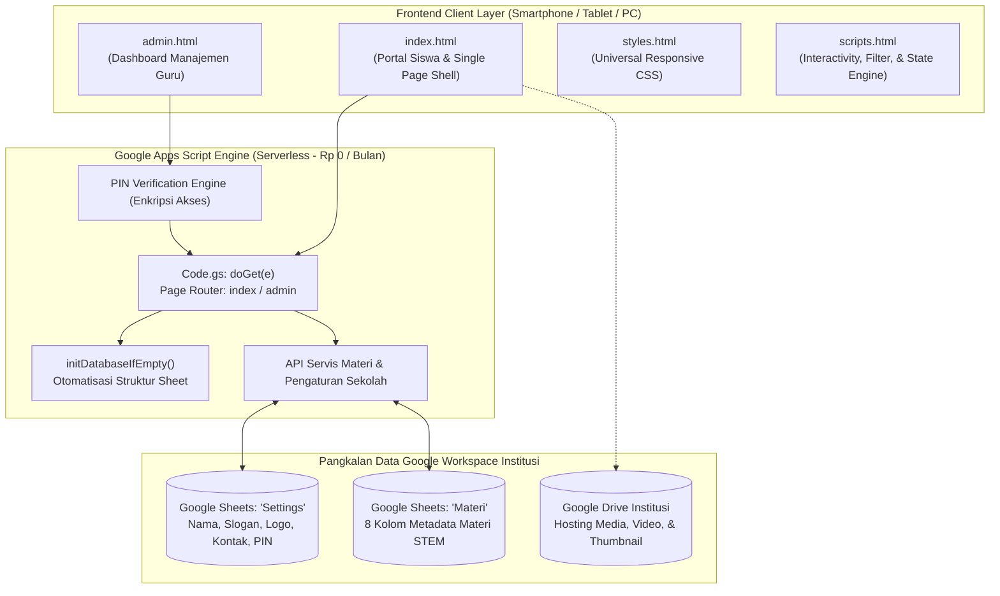
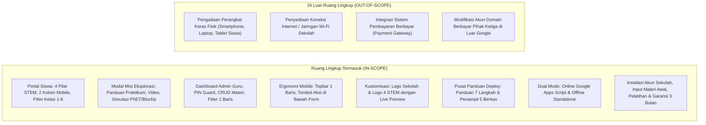
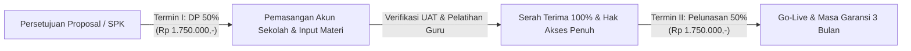
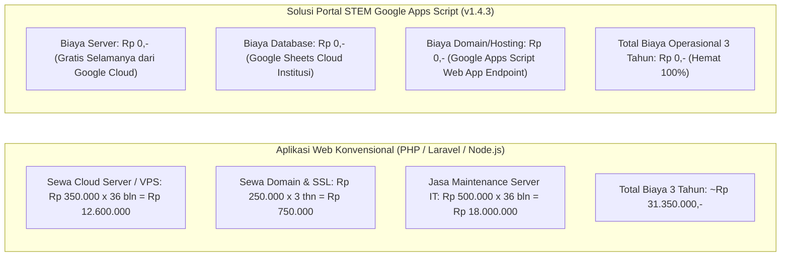

# 📑 DOKUMEN SPESIFIKASI TEKNIS & PROPOSAL PENAWARAN SISTEM
## SISTEM PORTAL PEMBELAJARAN STEM SEKOLAH BERBASIS GOOGLE APPS SCRIPT (GAS)
### Versi Rilis: v1.4.3 (Ready-to-Use Production System)

---

**Nomor Dokumen**: `PROP-STEM/2026/X/002-REV1`  
**Tanggal**: 26 Oktober 2026  
**Status**: Proposal Resmi & Dokumen Spesifikasi Sistem Siap Pakai  
**Disusun Oleh**: Tim Rekayasa Perangkat Lunak & Konsultan EdTech (Virtual Engineering Team)  
**Ditujukan Kepada**: Pimpinan / Kepala Sekolah & Tim Pengembang Kurikulum STEM  

---

## Executive Summary

Penerapan pendekatan **STEM (*Science, Technology, Engineering, Mathematics*)** di jenjang pendidikan dasar menjadi kunci dalam membangun nalar kritis, kreativitas, dan literasi digital peserta didik sejak dini. Namun, kendala utama yang kerap dihadapi sekolah adalah **tingginya biaya sewa server bulanan (*VPS / Cloud Hosting*)**, kerumitan instalasi aplikasi, serta kebutuhan tim teknis khusus untuk pemeliharaan rutin.

**Portal Pembelajaran STEM Sekolah Berbasis Google Apps Script (GAS)** hadir sebagai solusi komprehensif yang telah selesai dikembangkan dan siap pakai (*production-ready*):

1. **Biaya Infrastruktur Rp 0,- (Zero Server Cost Selamanya)**:  
   Berjalan 100% di atas komputasi awan Google Cloud Platform menggunakan akun Google Workspace institusi sekolah, dengan Google Sheets sebagai pangkalan data awan. Bebas biaya sewa server, domain, maupun database bulanan.
2. **Akses Instan Tanpa Instalasi (*Ultra-Fast Web App*)**:  
   Dapat diakses langsung melalui peramban web (*browser*) di smartphone, tablet, laptop, maupun Chromebook tanpa perlu mengunduh aplikasi dari Google Play Store atau Apple App Store.
3. **Pengelolaan Mandiri & Ramah Guru**:  
   Seluruh konten materi praktikum, identitas sekolah, logo instansi, serta tautan video dan simulasi dikelola dengan sangat mudah melalui Dashboard Admin visual atau langsung via *spreadsheet* Google Sheets yang sudah akrab bagi para pendidik.
4. **Desain Mobile-First & Ergonomis**:  
   Antarmuka beranda mengadopsi formasi 2 kolom kartu STEM yang seimbang di ponsel, filter 1 baris kompak, serta penempatan tombol aksi di bawah formulir demi kemudahan jangkauan jempol pengguna di perangkat bergerak.

Dokumen ini memaparkan **Spesifikasi Teknis Sistem Saat Ini (v1.4.3)**, **Ruang Lingkup Aplikasi (*Scope of Work*)**, **Rincian Estimasi Biaya Berdasarkan Peran & Fitur (Anggaran Rp 3.500.000,-)**, serta **Alur Pelaksanaan dan Serah Terima Sistem**.

---

## 1. Arsitektur Sistem & Spesifikasi Komponen

### 1.1 Struktur Arsitektur Google Apps Script (GAS)
Aplikasi dibangun menggunakan arsitektur modular murni Google Apps Script tanpa dependensi berkas `.css` atau `.js` eksternal terpisah (memenuhi regulasi resmi lingkungan Google Apps Script):



### 1.2 Struktur Berkas Proyek (*Deliverable Files*)

Platform terdiri atas 5 berkas inti yang terstruktur secara bersih:

| No | Nama Berkas | Peran & Fungsi Utama |
|:---:|---|---|
| 1 | **`Code.gs`** | Backend Google Apps Script: menangani routing web app (`doGet`), inisialisasi pangkalan data Google Sheets otomatis, CRUD materi, verifikasi keamanan PIN Admin, dan sinkronisasi data pengaturan. |
| 2 | **`index.html`** | Halaman muka portal siswa: menampilkan identitas sekolah, formasi 2 kolom kartu STEM, selektor jenjang kelas, dan modal misi eksplorasi praktikum interaktif. |
| 3 | **`styles.html`** | Sistem desain visual terpadu: palet warna HSL modern, formasi 2 kolom mobile, filter 1 baris kompak, topbar admin 1 baris, dan isolasi responsif bebas horizontal overflow. |
| 4 | **`admin.html`** | Dashboard admin guru mandiri (*standalone-ready*): autentikasi PIN, manajemen materi STEM, kustomisasi logo & profil sekolah, panduan deploy, dan penampil kode sumber. |
| 5 | **`scripts.html`** | Mesin interaktivitas klien: penanganan filter kelas, pencarian real-time, validasi formulir, integrasi Google Script Run API, dan fallback penyimpanan lokal (*cache*). |

---

## 2. Ruang Lingkup Aplikasi (*Scope of Work*)

Untuk memberikan kepastian batasan teknis dan hasil kerja (*deliverables*), ruang lingkup aplikasi dirumuskan secara tegas:



### 2.1 Batasan Pekerjaan Termasuk (*In-Scope Deliverables*)
1. **Modul Portal Pembelajaran Siswa**:
   - Tampilan beranda interaktif dengan kartu 4 pilar STEM (Science, Technology, Engineering, Mathematics) formasi 2 kolom ponsel.
   - Selektor jenjang kelas (*Grade-Locking Mechanism*) Kelas 1 hingga Kelas 6 SD.
   - Jendela modal misi eksplorasi (Tujuan Pembelajaran, Langkah Praktikum, Tautan Media Video & Simulasi PhET/Blockly/Games, serta Refleksi).
2. **Modul Dashboard Manajemen Guru & Keamanan**:
   - Autentikasi PIN Keamanan Admin (PIN demo default `123456` dan fitur ganti PIN baru).
   - Topbar admin terkunci 1 baris horizontal (*single-row no-wrap*) di ponsel.
   - Manajemen Konten Sub-Card Materi STEM (CRUD: Tambah, Edit, Hapus) dengan filter tabel 1 baris kompak.
   - Penempatan tombol aksi di bawah formulir/filter (*thumb-zone ergonomics*).
   - Kustomisasi profil sekolah (Nama, Tahun Ajaran, Slogan, No. WhatsApp Bantuan) dan logo sekolah serta logo khusus 4 pilar STEM dengan *Live Preview*.
3. **Pusat Penerapan Mandiri (*Self-Deployment Hub*)**:
   - Panduan 7 langkah deploy langsung di panel admin.
   - Penampil kode sumber interaktif (*Interactive Code Viewer*) untuk 5 berkas sumber dengan tombol salin 1-klik (*copy to clipboard*).
4. **Layanan Pemasangan, Pelatihan & Garansi**:
   - Pemasangan langsung (*setup/deployment*) ke akun Google resmi sekolah.
   - Konfigurasi pangkalan data Google Sheets sekolah.
   - Input data materi awal kurikulum STEM sekolah (12 materi percontohan).
   - 1 sesi pelatihan daring bagi guru dan staf IT sekolah (durasi 2 jam).
   - Masa garansi perbaikan bebas bug (*free bug-fixing*) selama 3 bulan penuh.

### 2.2 Batasan di Luar Pekerjaan (*Out-of-Scope*)
- Pengadaan perangkat keras fisik (*hardware*) seperti smartphone, tablet, komputer, atau proyektor.
- Penyediaan paket kuota data internet atau infrastruktur jaringan Wi-Fi sekolah.
- Integrasi sistem pembayaran komersial / *payment gateway* (portal dirancang murni non-komersial untuk edukasi siswa).

---

## 3. Rincian Estimasi Biaya Berdasarkan Peran & Fitur

Struktur estimasi investasi dirancang secara transparan, akuntabel, dan terukur dengan mengintegrasikan peran teknis spesialis, fitur yang dikerjakan, dan uraian tugas konkret, dengan **Total Anggaran Tetap: Rp 3.500.000,- (Tiga Juta Lima Ratus Ribu Rupiah)**:

| PERAN TEKNIS | FITUR YANG DIKERJAKAN | URAIAN PEKERJAAN | BIAYA (RP) |
|---|---|---|:---:|
| **UI/UX & Frontend Developer** | **Portal Siswa & Antarmuka Responsif Mobile** | • Pembuatan antarmuka visual beranda ramah anak dengan kartu 4 pilar STEM (Science, Technology, Engineering, Mathematics).<br>• Desain kartu interaktif formasi 2 kolom proporsional pada layar ponsel (*mobile-friendly*).<br>• Perancangan selektor jenjang kelas (*Grade-Locking Mechanism*) Kelas 1–6 SD.<br>• Pembuatan jendela modal misi eksplorasi praktikum interaktif (Tujuan, Langkah Praktikum, Tautan Video, Simulasi PhET/Blockly/Games, dan Refleksi).<br>• Optimasi tipografi dan tata letak universal responsif bebas *horizontal overflow*. | **1.200.000** |
| **Backend & Script Engineer** | **Dashboard Admin Guru, Alur Data & Keamanan PIN** | • Penulisan skrip backend Google Apps Script (`Code.gs`) dengan V8 runtime engine.<br>• Pembuatan dashboard admin guru terpadu dengan autentikasi proteksi PIN Keamanan (`123456` dan kustomisasi PIN baru).<br>• Mekanisme manajemen konten sub-card materi STEM (CRUD: Tambah, Edit, Hapus) terhubung Google Sheets.<br>• Optimasi topbar admin mobile terkunci 1 baris (*no-wrap*) dan filter tabel 1 baris kompak.<br>• Penataan tombol aksi di bawah formulir (*thumb-zone ergonomics*) untuk kemudahan sentuh di ponsel.<br>• Penanganan CORS-free untuk mode luring mandiri (*standalone*). | **1.350.000** |
| **Data & EdTech Specialist** | **Integrasi Google Sheets, Kustomisasi & Kurasi STEM** | • Perancangan struktur database Google Sheets (`Settings` & `Materi`) dan inisialisasi tabel otomatis.<br>• Pembuatan formulir kustomisasi nama sekolah, slogan, kontak WhatsApp, dan logo sekolah serta 4 logo pilar STEM dengan *Live Preview* real-time.<br>• Kurasi dan input 12 data awal materi praktikum STEM SD terhubung ke simulasi resmi PhET dan video edukasi.<br>• Optimasi tautan hosting aset dan thumbnail di Google Drive sekolah. | **550.000** |
| **QA Specialist & Deployment Facilitator** | **Pengujian Sistem, Panduan Deploy & Pelatihan Guru** | • Pengujian fungsionalitas menyeluruh dan kompatibilitas lintas peramban/perangkat (Android, iOS, PC).<br>• Pembuatan modul *Interactive Code Viewer* 5 berkas proyek (`Code.gs`, `index.html`, `styles.html`, `admin.html`, `scripts.html`) dengan tombol salin 1-klik.<br>• Penyusunan dokumen panduan penerapan 7 langkah (*Deployment Guide*) dan buku petunjuk operasional guru (*User Manual*).<br>• Pelaksanaan 1 sesi pelatihan daring bagi guru dan staf IT sekolah (durasi 2 jam) serta pendampingan masa garansi 3 bulan. | **400.000** |
| **TOTAL (GOOGLE APPS SCRIPT READY-TO-USE)** | | | **Rp3.500.000** |

---

### 3.3 Skema Jadwal Pembayaran (*Payment Terms*)

Pembayaran dibagi ke dalam 2 termin yang seimbang dan transparan:



1. **Termin I (Uang Muka / Down Payment - 50%)**:  
   Sebesar **Rp 1.750.000,-** dibayarkan saat penandatanganan lembar persetujuan proposal / penerbitan Surat Perintah Kerja (SPK).
2. **Termin II (Pelunasan Akhir - 50%)**:  
   Sebesar **Rp 1.750.000,-** dibayarkan setelah seluruh sistem berhasil terpasang di akun Google sekolah, berfungsi 100%, dan sesi pelatihan daring guru selesai dilaksanakan.

---

## 4. Analisis Efisiensi Biaya (TCO - Total Cost of Ownership)

Perbandingan pengeluaran operasional infrastruktur sistem Portal STEM berbasis Google Apps Script dibandingkan sistem web konvensional selama 3 tahun operasional:



> **Keuntungan Finansial Institusi**: Memilih arsitektur Google Apps Script mengeliminasi 100% beban biaya operasional server, menghemat kas sekolah **lebih dari Rp 30.000.000,-** selama 3 tahun masa pakai. Total investasi Rp 3.500.000,- adalah biaya satu kali (*one-time fee*) tanpa biaya bulanan apa pun ke depannya.

---

## 5. Alur Pelaksanaan & Serah Terima (*Onboarding Workflow*)

Karena perangkat lunak telah selesai dibangun dan teruji (v1.4.3), proses penerapan hingga peluncuran (*go-live*) di sekolah dapat diselesaikan dalam waktu **2 hingga 3 hari kerja**:

```
Hari ke-1: Penyelarasan & Penyiapan Akun
├── Kick-off singkat via daring bersama perwakilan sekolah
├── Penerimaan data identitas sekolah (Nama, Slogan, Logo, Nomor WhatsApp Bantuan)
└── Penyiapan Google Spreadsheet dan Google Drive di akun Google sekolah

Hari ke-2: Deployment & Kustomisasi
├── Pemasangan skrip backend Code.gs dan berkas HTML di Google Apps Script sekolah
├── Konfigurasi hak akses web app (*Anyone with Google Account / Anyone*)
├── Input 12 materi praktikum awal dan pengujian fungsi tombol/simulasi
└── Penyesuaian PIN Admin sesuai permintaan pihak sekolah

Hari ke-3: Verifikasi Bersama & Pelatihan
├── Uji coba akses dari peramban smartphone guru dan siswa
├── Sesi pelatihan daring guru mengenai tata cara tambah/edit materi di dashboard admin
├── Penyerahan dokumen panduan operasional resmi dan repositori berkas
└── Peluncuran resmi (*Go-Live*) kepada siswa sekolah
```

---

## 6. Syarat & Ketentuan Layanan (*Service Terms*)

1. **Kebutuhan Teknis Pihak Sekolah**:
   - 1 Akun Google / Google Workspace for Education resmi sekolah (gratis dari Google / Kemendikbudristek).
   - Berkas logo resmi sekolah (PNG/JPG) dan daftar kontak bantuan.
2. **Jaminan Kualitas & Garansi (SLA)**:
   - Jaminan perbaikan bebas biaya (*free bug-fixing*) selama 3 bulan terhitung sejak tanggal *go-live*.
   - Hak kepemilikan data 100% berada di bawah kendali akun Google resmi sekolah tanpa perantara pihak ketiga.
   - Bantuan konsultasi teknis operasional melalui grup WhatsApp khusus.

---

## 7. Lembar Konfirmasi & Persetujuan

Untuk menyetujui proposal spesifikasi teknis dan penawaran harga ini, silakan mengisi lembar persetujuan di bawah ini atau memberikan surat konfirmasi balasan resmi:

| Disetujui Oleh (Pihak Sekolah) | Diajukan Oleh (Tim Pengembang) |
|---|---|
| <br><br><br>____________________________________<br>Nama: <br>Jabatan: <br>Tanggal: | <br><br><br>____________________________________<br>Nama: **Lead Solution Architect**<br>Jabatan: **Lead EdTech Consultant**<br>Tanggal: 26 Oktober 2026 |

---
*Dokumen ini disusun dengan mengedepankan efisiensi anggaran institusi pendidikan, keandalan komputasi awan Google Workspace, dan kemudahan akses belajar bagi seluruh siswa.*
